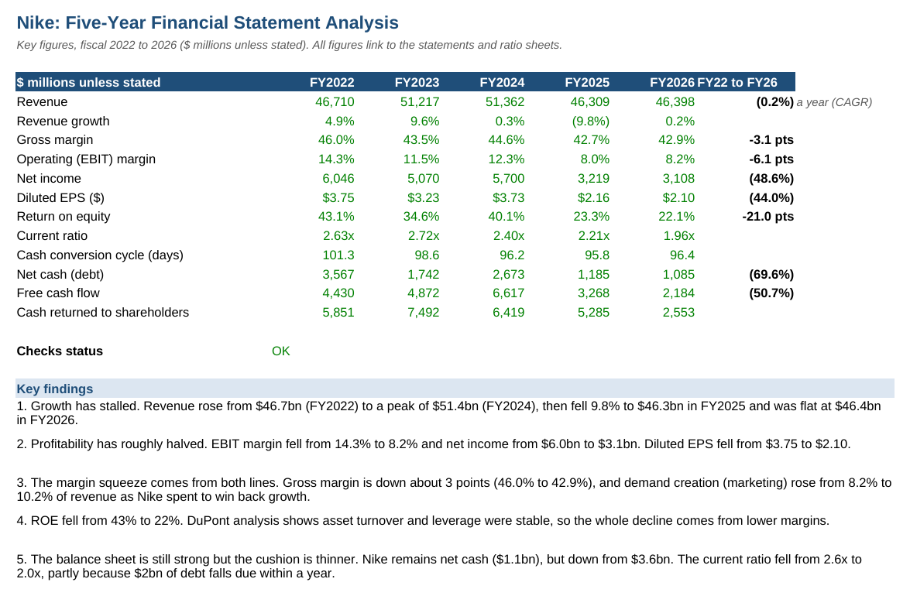
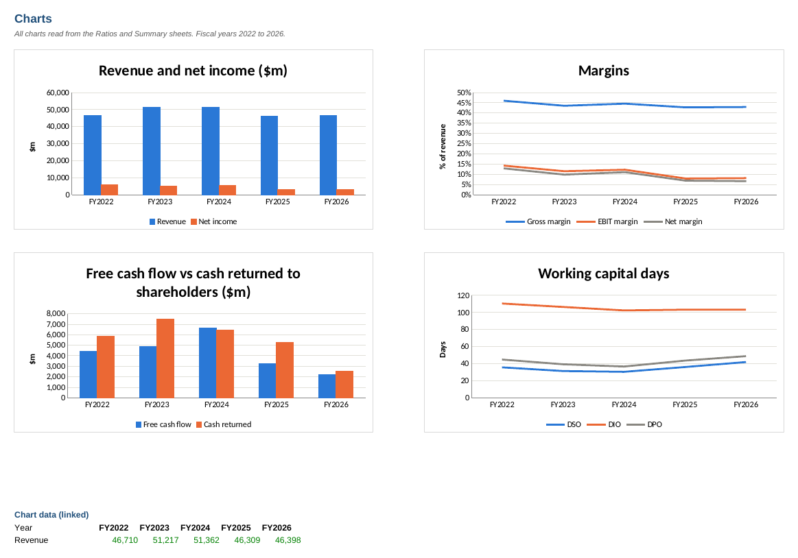
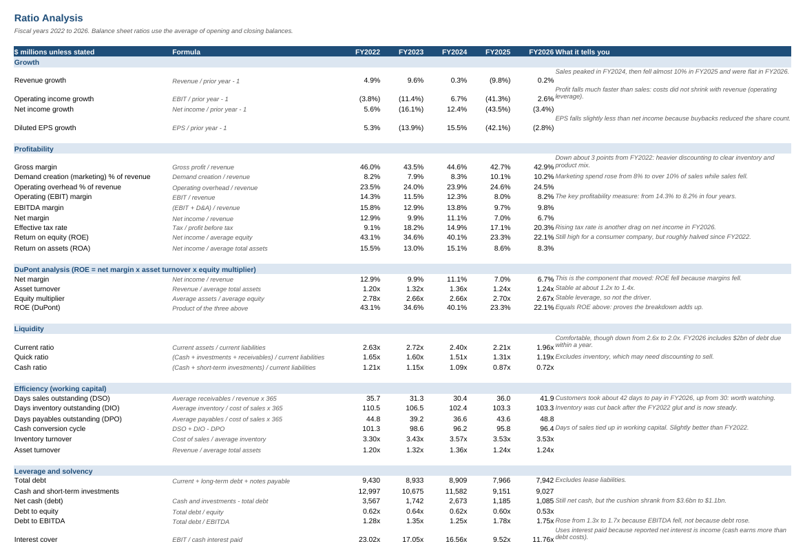
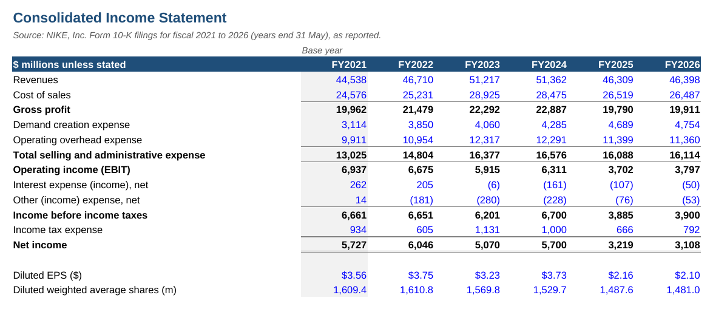
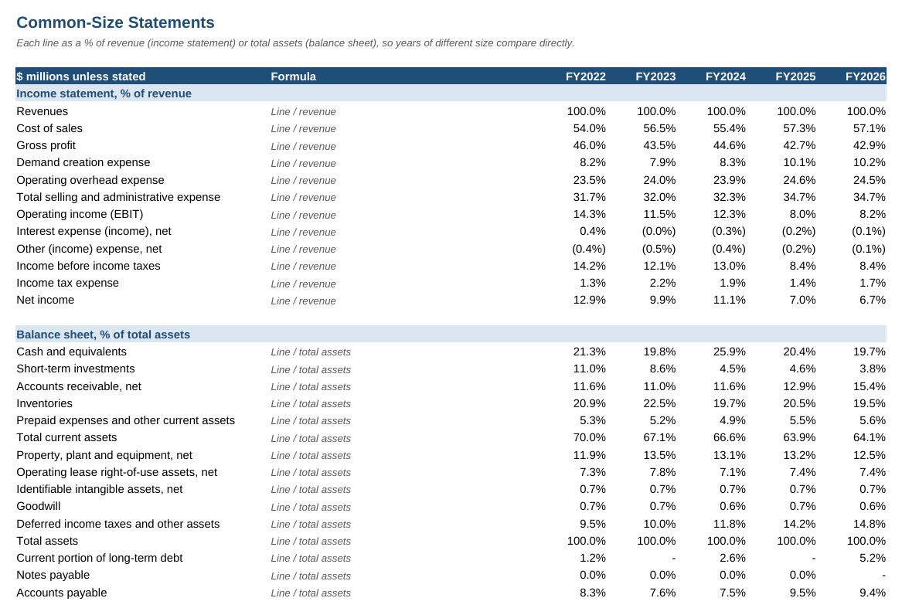

# Financial Statement Analysis: Nike, FY2022 to FY2026

A five-year analysis of Nike's performance from its published annual reports, covering growth, profitability, efficiency, liquidity, leverage and cash flow. Built in Excel, with every ratio as a live formula.

**Downloads:** [⬇ Excel workbook](https://github.com/MuhammedAnshajK/financial-statement-analysis/raw/main/nike_financial_analysis.xlsx) · [⬇ PDF version](https://github.com/MuhammedAnshajK/financial-statement-analysis/raw/main/nike_financial_analysis.pdf) · [⬇ Data (CSV)](https://github.com/MuhammedAnshajK/financial-statement-analysis/raw/main/data/nike_financials.csv) · [⬇ Python script](https://github.com/MuhammedAnshajK/financial-statement-analysis/raw/main/build_analysis.py)

## Key findings

1. **Growth has stalled.** Revenue peaked at $51.4bn in FY2024, fell 9.8% to $46.3bn in FY2025 and was flat at $46.4bn in FY2026.
2. **Profitability has roughly halved.** Operating (EBIT) margin fell from 14.3% to 8.2%. Net income fell from $6.0bn to $3.1bn and diluted EPS from $3.75 to $2.10.
3. **Both gross margin and costs squeezed profit.** Gross margin fell by about 3 points (46.0% to 42.9%), and marketing ("demand creation") rose from 8.2% to 10.2% of revenue as Nike spent to restart growth.
4. **ROE fell from 43% to 22%.** A DuPont breakdown shows asset turnover and leverage barely moved, so the whole fall came from lower margins.
5. **The balance sheet is still strong but thinner.** Nike still holds more cash than debt, but its net cash fell from $3.6bn to $1.1bn. The current ratio fell from 2.6x to 2.0x, partly because $2bn of debt is due within a year.
6. **Cash returns outran cash generation.** Over the five years Nike returned $27.6bn through buybacks and dividends but generated $21.4bn of free cash flow. It cut buybacks to $0.1bn in FY2026 and kept raising the dividend.
7. **Working capital is mixed.** Inventory days are steady at about 103 now that the FY2022 excess stock has been cleared. Receivable days rose from 30 to 42, which held back FY2026 cash flow: free cash flow was only 70% of net income.

**Overall:** Nike is financially solid but in a turnaround. The thing to watch is whether sales growth and gross margin recover enough to justify the higher marketing spend.

## Data

The income statement, balance sheet and cash flow statement come from Nike's Form 10-K annual reports for fiscal 2021 to 2026, on [SEC EDGAR](https://www.sec.gov/cgi-bin/browse-edgar?action=getcompany&CIK=0000320187&type=10-K). Nike's fiscal year ends on 31 May. FY2021 is used only as the base year for growth rates and average balances. Figures are in $ millions, as reported.

The model recalculates every subtotal from the line items, and the **Checks** sheet reconciles each one to the totals Nike reported. It also confirms the balance sheet balances and ending cash agrees to the balance sheet. All checks show OK.

## Approach

1. **Statements.** I typed the three statements into Excel as inputs and rebuilt every subtotal as a formula.
2. **Common-size analysis.** Each income statement line is shown as a % of revenue and each balance sheet line as a % of total assets, so years of different size can be compared directly.
3. **Trend analysis.** Year-on-year growth in revenue, operating income, net income and EPS.
4. **Ratio analysis.** 41 ratios and measures in six groups, each with its formula and a note on what it shows:
   - **Profitability:** gross, EBIT, EBITDA and net margins, cost ratios, tax rate, ROE, ROA
   - **DuPont:** ROE broken into net margin x asset turnover x equity multiplier
   - **Liquidity:** current, quick and cash ratios
   - **Efficiency:** DSO, DIO, DPO, cash conversion cycle, inventory and asset turnover
   - **Leverage:** total debt, net cash, debt to equity, debt to EBITDA, interest cover
   - **Cash flow:** free cash flow, FCF margin and conversion, cash returned to shareholders
5. **Averages.** Ratios that compare a flow with a balance (such as ROE and DSO) use the average of the opening and closing balance.
6. **Summary and charts.** A one-page summary of key figures with written findings, plus six charts.

## Screenshots

| Charts | Ratio analysis |
|---|---|
|  |  |

| Income statement | Common-size statements |
|---|---|
|  |  |

## How to use

1. Download `nike_financial_analysis.xlsx` and start with the **Summary** sheet.
2. To analyse another company, replace the blue numbers on the three statement sheets, or edit `data/nike_financials.csv` and run `python build_analysis.py`. Every ratio, chart and check updates.
3. Check that the **Checks** sheet still says **OK**.

Colour key: blue = input from the 10-K, black = formula, green = link to another sheet.

## Files

- `nike_financial_analysis.xlsx`: the analysis workbook (Cover, Summary, Charts, Income Statement, Balance Sheet, Cash Flow, Common Size, Ratios, Checks)
- `nike_financial_analysis.pdf`: print-ready PDF of every sheet
- `data/nike_financials.csv`: the statements as reported, FY2021 to FY2026
- `build_analysis.py`: Python script (openpyxl) that builds the workbook from the CSV
- `images/`: screenshots

## Limitations

- The analysis uses reported figures only. It does not adjust for one-off items, currency movements or restructuring costs.
- Debt ratios exclude operating lease liabilities (about $3.1bn in FY2026).
- A natural next step would be a peer comparison with adidas, Puma or Lululemon, and a segment view (North America, Greater China, Nike Direct vs wholesale).

## Tools

Excel, Python (openpyxl), financial statement analysis

*Not investment advice. This is an educational analysis of public information.*
